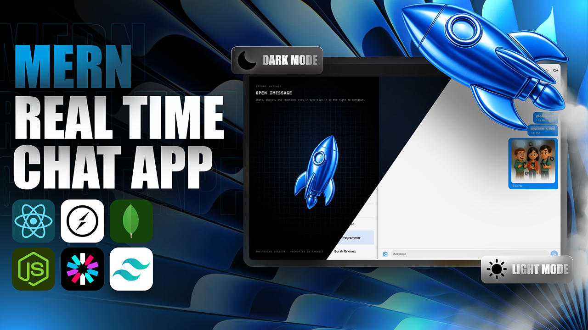

<div align="center">


# IMESSAGE

**A real-time chat app built with the MERN stack, Clerk, and Socket.IO.**

Sign in securely, find people, send messages and media instantly, and see who's online, all in a clean, themeable interface.

[Report a Bug](https://github.com/pavankumarchoudari/IMESSAGE/issues) · [Request a Feature](https://github.com/pavankumarchoudari/IMESSAGE/issues)


</div>

---



## Table of Contents

- [Features](#-features)
- [Tech Stack](#-tech-stack)
- [Architecture](#-architecture)
- [Project Structure](#-project-structure)
- [Getting Started](#-getting-started)
- [Environment Variables](#-environment-variables)
- [Clerk Webhook Setup](#-clerk-webhook-setup)
- [Scripts](#-scripts)
- [API Reference](#-api-reference)
- [Data Models](#-data-models)
- [Deployment](#-deployment)
- [Roadmap](#-roadmap)
- [Author](#-author)

## 🚀 Features

- **Secure authentication**: sign-up and sign-in handled by [Clerk](https://clerk.com), with every API route protected.
- **Real-time messaging**: messages are pushed to recipients instantly over Socket.IO.
- **Online presence**: see which users are online right now.
- **Media sharing**: send images and videos (up to 25 MB), stored via [ImageKit](https://imagekit.io).
- **Conversations**: a sidebar of recent chats sorted by latest activity, plus a directory of all users.
- **Webhook user sync**: Clerk user events (created, updated, deleted) keep MongoDB profiles up to date automatically.
- **Personalization**: 11 HeroUI theme presets, light/dark mode, and 13 chat wallpapers.
- **Keystroke sounds**: optional typing sound effects while composing a message.
- **Single-container deploy**: one Docker image serves both the API and the built frontend.
- **Keep-alive job**: a cron health ping prevents free-tier hosts from sleeping in production.

## 🛠️ Tech Stack

| Layer | Technologies |
|---|---|
| Frontend | React 19, Vite, React Router 7, Zustand, Axios, React Hot Toast, Lucide Icons |
| Styling | Tailwind CSS 4, HeroUI |
| Backend | Node.js, Express 5, Multer |
| Database | MongoDB Atlas, Mongoose |
| Auth | Clerk (`@clerk/react`, `@clerk/express`) |
| Real-time | Socket.IO |
| Media | ImageKit |
| DevOps | Docker (multi-stage build), Render |

## 🧩 Architecture

```text
┌──────────────┐   HTTPS /api   ┌───────────────────┐   Mongoose   ┌───────────────┐
│  React SPA   │ ─────────────► │  Express 5 API    │ ───────────► │ MongoDB Atlas │
│  (Vite)      │                │  + Clerk auth     │              └───────────────┘
│              │ ◄───────────── │  + Multer uploads │ ──► ImageKit (media storage)
└──────┬───────┘   WebSocket    │  + Socket.IO      │
       │      (Socket.IO)       └─────────▲─────────┘
       └────────────────────────────────┘
                                          │ signed webhook
                                  ┌───────┴───────┐
                                  │     Clerk     │  user.created / updated / deleted
                                  └───────────────┘
```

1. A user signs in through Clerk on the frontend.
2. Clerk sends a signed webhook to the backend, which upserts the user in MongoDB.
3. Authenticated requests load users, conversations, and message history.
4. Sending a message saves it to MongoDB. If the recipient is online, it is also emitted live over Socket.IO.
5. Attached media is uploaded to ImageKit and the returned URL is stored on the message.

## 📂 Project Structure

```text
IMESSAGE/
├── Dockerfile                  # Multi-stage build: frontend + backend in one image
├── frontend/
│   ├── public/                 # Logo, wallpapers, keystroke sounds
│   └── src/
│       ├── components/         # auth/, chat/, theme & wallpaper pickers
│       ├── context/            # Theme and wallpaper providers
│       ├── data/               # Wallpaper and HeroUI theme preset definitions
│       ├── hooks/              # useMediaQuery, useKeyboardSound, useScrollToBottom, ...
│       ├── lib/                # Axios instance, ImageKit helper, utils
│       ├── pages/              # AuthPage, ChatPage
│       └── store/              # Zustand stores (auth, chat)
└── backend/
    ├── middleware/             # Auth (Clerk) and upload (Multer) middleware
    └── src/
        ├── controllers/        # auth, message
        ├── lib/                # db, socket, imagekit, cron
        ├── models/             # User, Message
        ├── routes/             # auth, message
        ├── seeds/              # Demo user seeder
        ├── webhooks/           # Clerk webhook handler
        └── index.js            # Server entry point
```

## ⚡ Getting Started

### Prerequisites

- [Node.js](https://nodejs.org/) 20+ (22 recommended) and npm
- A [MongoDB Atlas](https://www.mongodb.com/atlas) cluster
- A [Clerk](https://clerk.com) application
- An [ImageKit](https://imagekit.io) account (needed only for media uploads)

### 1. Clone the repository

```bash
git clone https://github.com/pavankumarchoudari/IMESSAGE.git
cd IMESSAGE
```

### 2. Install dependencies

```bash
# Backend
cd backend
npm install

# Frontend (from the project root, in a second terminal)
cd frontend
npm install
```

### 3. Configure environment variables

Create a `.env` file in both `backend/` and `frontend/`. See [Environment Variables](#-environment-variables) below.

### 4. Run the app

Use two terminals:

```bash
# Terminal 1: API on http://localhost:3000
cd backend
npm run dev

# Terminal 2: frontend on http://localhost:5173
cd frontend
npm run dev
```

Open **http://localhost:5173** in your browser.

> In development, the frontend talks to the API at `http://localhost:3000`, so keep `PORT=3000` in your backend `.env`.

## 🔐 Environment Variables

**`frontend/.env`**

```env
VITE_CLERK_PUBLISHABLE_KEY=your_clerk_publishable_key
```

**`backend/.env`**

```env
PORT=3000
NODE_ENV=development
FRONTEND_URL=http://localhost:5173

MONGO_URI=your_mongodb_connection_string

CLERK_PUBLISHABLE_KEY=your_clerk_publishable_key
CLERK_SECRET_KEY=your_clerk_secret_key
CLERK_WEBHOOK_SIGNING_SECRET=your_clerk_webhook_signing_secret

IMAGEKIT_PRIVATE_KEY=your_imagekit_private_key
```

| Variable | Required | Description |
|---|---|---|
| `PORT` | Yes | Port the Express server listens on |
| `NODE_ENV` | No | Set to `production` to enable the keep-alive cron job |
| `FRONTEND_URL` | Yes | Allowed CORS and Socket.IO origin; also the host pinged by the keep-alive job |
| `MONGO_URI` | Yes | MongoDB connection string |
| `CLERK_PUBLISHABLE_KEY` / `CLERK_SECRET_KEY` | Yes | Clerk API keys |
| `CLERK_WEBHOOK_SIGNING_SECRET` | Yes | Verifies incoming Clerk webhooks |
| `IMAGEKIT_PRIVATE_KEY` | For media | Enables image and video uploads |

> ⚠️ Never commit `.env` files or secret keys. `.env` is already in `.gitignore`.

## 🪝 Clerk Webhook Setup

Users are created in MongoDB through Clerk webhooks, so this step is required for new sign-ups to appear in the app.

1. In the Clerk Dashboard, go to **Webhooks → Add Endpoint**.
2. Set the URL to `https://<your-domain>/api/webhooks/clerk`.
3. Subscribe to `user.created`, `user.updated`, and `user.deleted`.
4. Copy the **Signing Secret** into `CLERK_WEBHOOK_SIGNING_SECRET`.

For local development, expose your backend with a tunnel such as [ngrok](https://ngrok.com) or the [Clerk CLI](https://clerk.com/docs), and use the tunnel URL for the endpoint.

## 📜 Scripts

| Location | Command | Description |
|---|---|---|
| `backend` | `npm run dev` | Start the API with nodemon |
| `backend` | `npm start` | Start the API in production mode |
| `backend` | `npm run build` | Copy `src/` to `dist/` for the Docker build |
| `backend` | `npm run db:seed` | Insert demo users into MongoDB |
| `frontend` | `npm run dev` | Start the Vite dev server |
| `frontend` | `npm run build` | Create a production build |
| `frontend` | `npm run lint` | Lint with ESLint |
| `frontend` | `npm run preview` | Preview the production build |

## 📡 API Reference

All `/api/auth` and `/api/messages` routes require a valid Clerk session.

| Method | Endpoint | Description |
|---|---|---|
| `GET` | `/health` | Health check (public) |
| `POST` | `/api/webhooks/clerk` | Clerk webhook receiver (signature verified) |
| `GET` | `/api/auth/check` | Return the authenticated user |
| `GET` | `/api/messages/users` | List all users except yourself |
| `GET` | `/api/messages/conversations` | List users you've chatted with, newest first |
| `GET` | `/api/messages/:id` | Message history with user `:id` |
| `POST` | `/api/messages/send/:id` | Send a message to user `:id` (`multipart/form-data`: `text`, optional `media`) |

### Socket.IO events

| Event | Direction | Payload |
|---|---|---|
| `getOnlineUsers` | Server → Client | Array of online user IDs |
| `newMessage` | Server → Client | The saved message document |

The client connects with `userId` in the handshake query.

## 🗄️ Data Models

**User**: `clerkId` (unique), `email` (unique), `fullName`, `profilePic`, timestamps

**Message**: `senderId`, `receiverId`, `text`, `image`, `video`, timestamps

## 🐳 Deployment

The included multi-stage `Dockerfile` builds the React app and the API into a single image. Express serves the API and the static frontend from the same origin on port `3001`.

```bash
docker build \
  --build-arg VITE_CLERK_PUBLISHABLE_KEY=your_clerk_publishable_key \
  -t imessage .

docker run -p 3001:3001 \
  -e MONGO_URI=... \
  -e FRONTEND_URL=http://localhost:3001 \
  -e CLERK_PUBLISHABLE_KEY=... \
  -e CLERK_SECRET_KEY=... \
  -e CLERK_WEBHOOK_SIGNING_SECRET=... \
  -e IMAGEKIT_PRIVATE_KEY=... \
  imessage
```

The image can be deployed to any container host, such as [Render](https://render.com). Use the same environment variables there, and set `NODE_ENV=production` so the keep-alive job pings `/health` every 14 minutes.

## 🗺️ Roadmap

- [ ] Read receipts and typing indicators
- [ ] Group chats
- [ ] Message deletion and editing
- [ ] Push notifications
- [ ] Unit and integration tests

## 👨‍💻 Author

**Pavan Kumar Choudari**

GitHub: [@pavankumarchoudari](https://github.com/pavankumarchoudari)

---

<div align="center">

⭐ If you like this project, consider giving it a star!

Built with ❤️ using the MERN stack.

</div>
